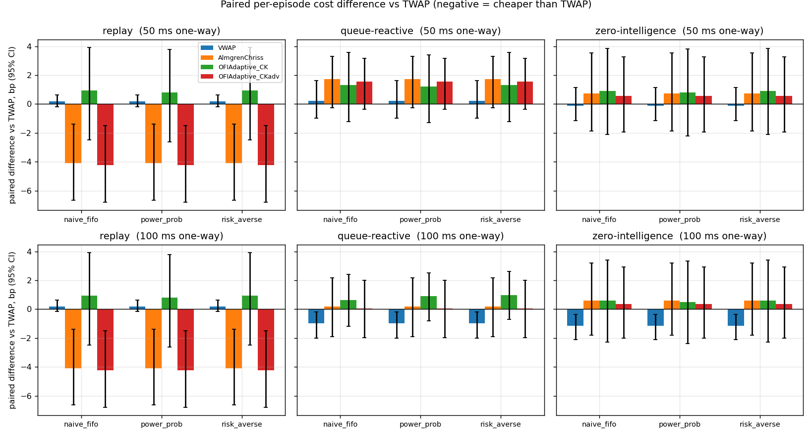
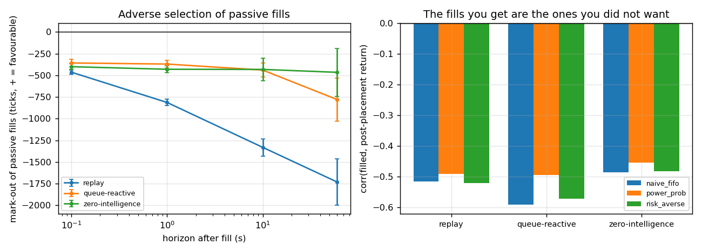

# lob-execution-sim

An order-book execution simulator in C++20 with three market models, a FIX 4.4 gateway and transaction-cost analysis, run on order-book data I recorded from Binance, Coinbase and Bitstamp on 15 September 2026.

The question: how much does the choice of simulator change the ranking of execution algorithms, and what does an order-flow-aware scheduler save once queue position and fills are modelled properly?

## Results

- **The ranking depends on the simulator.** TWAP, VWAP, Almgren–Chriss and two OFI-adaptive Cont–Kukanov schedulers come out in a different order in each mode: replay, queue-reactive and zero-intelligence give three orderings at 50 ms latency, and three again at 100 ms.
- **Passive fills are adversely selected in every mode.** A limit order at the touch that gets filled is marked out 300–500 ticks against you within 100 ms, and about −1,700 ticks (−2.3 bp) after 60 s in replay. Being filled is negatively correlated with the next return (about −0.5).
- **Charging that cost decides the scheduler.** In replay, the OFI scheduler that charges passive fills their measured mark-out beats TWAP by 4.2 bp. The naive version posts 94 % of the order passively and is the worst algorithm. In the queue-reactive mode, front-loading pays impact and TWAP comes first.
- **L2 queue models overstate the queue ahead.** Checked against 21,687 real Bitstamp orders at the touch, every queue-position model overestimates the queue ahead by about 20 %.

Implementation shortfall against TWAP in bp, 50 ms latency, naive FIFO queue, paired 95 % intervals over 12 episodes (negative is cheaper):

| Scheduler | Replay | Queue-reactive |
|---|---|---|
| Almgren–Chriss | −4.10 [−6.64, −1.38] | +1.72 [−0.26, +3.31] |
| OFI Cont–Kukanov, mark-out charged | −4.24 [−6.80, −1.50] | +1.56 |
| OFI Cont–Kukanov, naive | +0.93 [−2.47, +3.93] | +1.32 |

One replay episode falls in a gap in the recording and has zero shortfall. Over the other 11 the replay edges are −4.47 and −4.63 bp, and no ranking changes.




All numbers are in `results/summary.md` and `results/bench.md`; the detail is in [docs/method.md](docs/method.md).

## How it works

- **Data.** Binance BTCUSDT depth and trades (2.8 h, 448k messages; the rebuilt book matches 63,248 price levels of Binance's own snapshots with no mismatch), Coinbase BTC-USD level 2 (2.8 h) and Bitstamp's order-level feed (1.3 h). Crypto stands in for equities and FX: the methods are the ones published there.
- **Three modes behind one order interface.** Replay with queue position, using hftbacktest's three queue rules, which has no impact by construction. The Huang–Lehalle–Rosenbaum (2015) queue-reactive model, calibrated per level and queue size, with imbalance-conditioned price jumps for this small-tick book. A zero-intelligence Poisson book (Abergel–Jedidi 2013) as the null.
- **Schedulers.** TWAP, VWAP, Almgren–Chriss, and an OFI-adaptive Cont–Kukanov (2017) scheduler with and without the measured mark-out charged to passive fills. Shortfall is split into spread, impact, timing and opportunity.
- **FIX 4.4 gateway** around any mode. A self-test confirms identical fills in-process and over FIX for every algorithm.
- **Storage.** A Parquet and DuckDB research layer, plus kdb+ tick-store scripts.

## Limitations

- One recorded day, so the intervals are over episodes within that day.
- The queue-reactive mode adds a price-jump layer that is not in the 2015 model, and its impact response has the right shape but is about 30 times too small.
- Replay fills an order when the price trades through it, so part of its mark-out comes from that rule itself.
- The kdb+ scripts are written but have not been run.

## Run

```
./build.ps1                     # MSVC + Ninja; or: cmake -S . -B build -G Ninja && cmake --build build
./build/known_answer_tests      # 52 checks
python tools/recorder/recorder.py --out data/raw --minutes 120 --bitstamp btcusd
scripts/run_all.sh 2026-09-15 <bitstamp clean-start rx ns>
```

CI builds the engine, runs the tests and runs a synthetic pipeline end to end.
